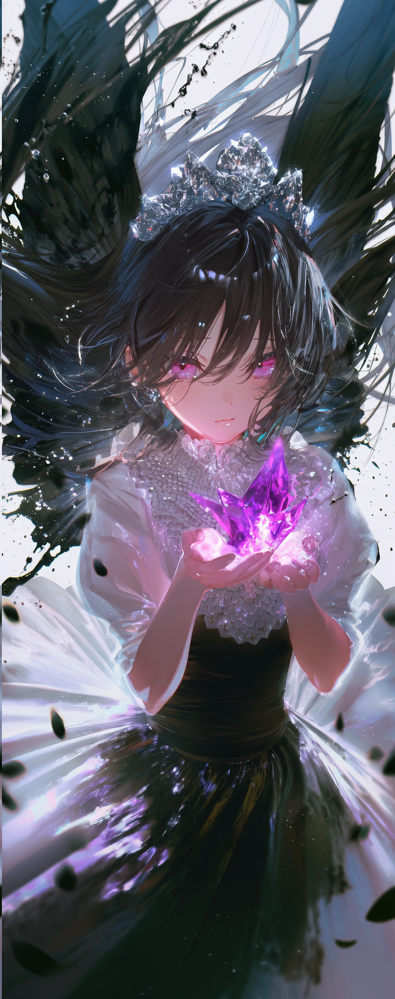
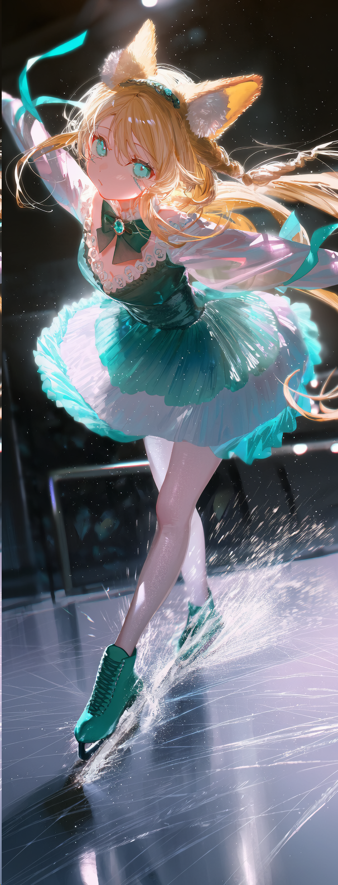
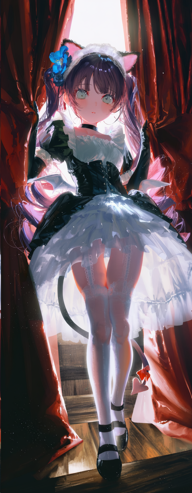
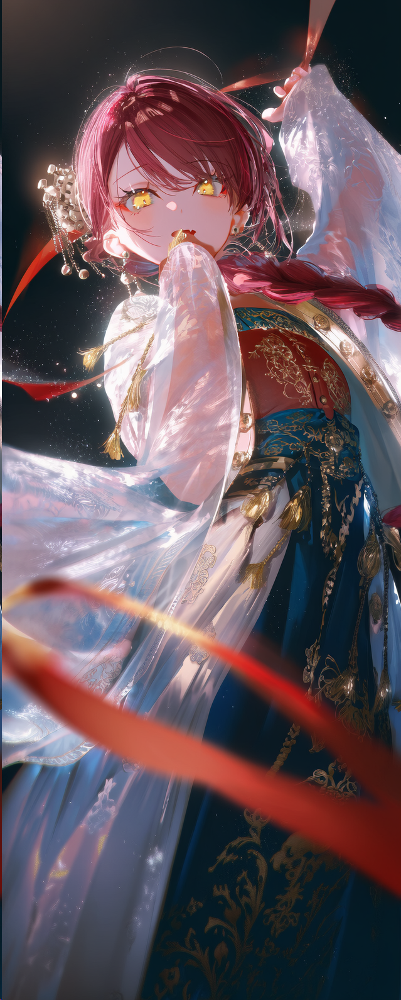

# TAG

[简体中文](README.md) | [English](README.en.md) | [한국어](README.ko.md) | [Русский](README.ru.md)

A skill for creating AI image-generation prompts. Based on requirements for characters, actions, composition, environment, and style, it generates prompts suited to different image models.

If you like it, give the repository a star.

## Installation

This skill requires no additional dependencies. Just clone the repository into the appropriate skills directory.

### Claude Code

Windows CMD:

```cmd
git clone https://github.com/1756141021/tag-skill "%USERPROFILE%\.claude\skills\tag"
```

macOS / Linux:

```bash
git clone https://github.com/1756141021/tag-skill ~/.claude/skills/tag
```

After installation, you can let Claude invoke the skill automatically or enter `/tag` to invoke it manually. If `.claude/skills` was created for the first time after the current Claude Code session started, restart Claude Code.

### Pi

Windows CMD:

```cmd
git clone https://github.com/1756141021/tag-skill "%USERPROFILE%\.pi\agent\skills\tag"
```

macOS / Linux:

```bash
git clone https://github.com/1756141021/tag-skill ~/.pi/agent/skills/tag
```

After installation, you can let Pi load the skill automatically or enter `/skill:tag` to invoke it manually.

## Optional Personalization Files

Users can create the following files in `references/` as needed. They store personal creative preferences and are not required for the skill to run.

- **OC appearance library** (`oc-library.md`): Stores visible features such as hair color, eye color, hairstyle, body type, and species traits by character name. When you specify a character, the skill extracts these features and integrates them into the prompt according to the image's visual flow instead of copying the template wholesale.
- **Creative context** (`context-anchor.md`): Stores creative conventions, language habits, and vocabulary preferences that you want to use over the long term.
- **Used poem lines record** (`used-poems.md`): Records the date of use, the source of each poem line, and a brief description of the image to reduce short-term reuse of the same line.

When you do not have an OC library, or the specified character is not in the library, provide the character's appearance directly in your request.

## Sources and Acknowledgements

The creative method behind this skill was distilled from the TAG codex by **戒红所** (`red_relief_reformatory`) and incorporates the author's own understanding of prompts and small creative touches. The original source of the method is credited here.


This repository organizes the codex's creative techniques into an executable skill workflow and platform-specific output rules.

The initial distillation of this skill was completed during the Opus 4.6 era and carried out with Opus 4.6. Because of limitations in the model's capabilities and in the way the material was organized at the time, its results may be less effective than those produced by redistilling it with Fable or another current model.

## Supported Formats

### Stable Diffusion (SD)

Use English natural-language action descriptions together with Danbooru TAGs, along with A1111 weight syntax such as `(tag:1.3)`, `[tag]`, and `BREAK`.

### NovelAI (NAI)

Use English natural-language action descriptions together with Danbooru TAGs, converted to NovelAI weight syntax such as `{tag}`, `1.2::tag::`, and `[tag]`.

### Anima

Use **SD TAG + natural-language descriptions**. Natural language handles actions, poses, character interactions, and spatial relationships; SD TAG handles appearance, clothing, scenes, and visual effects.

### Krea 2

Use **Chinese natural language only**, with a complete description of the subject, action, pose, composition, environment, lighting, and visual style. Do not use Danbooru TAGs or weight syntax.

> No dedicated research has yet been conducted on Anima and Krea 2. The text above records the output formats agreed upon at this stage; it does not represent systematic validation or optimization for the models' characteristics.

## Creative Results

The following four sets of results all begin by inferring the characters' appearances from reference images. The skill then freely designs the actions, compositions, scenes, and color schemes while preserving each character's distinctive features.

### 1. Amethyst and Ink Wings



<details>
<summary>View prompt</summary>

```text
A crowned black-haired girl crushes a violet crystal between her palms, and its light erupts into two enormous ink-black wings as her hair lashes outward,
1.5::shattering violet crystal, black liquid wings bursting from her back, overwhelming magical pressure, figure filling the frame::, {{ink black, paper white, electric violet and smoke gray theme}}, 1girl, solo, pale skin, very long black hair, straight bangs, glowing purple eyes, silver crystal crown, cold focused expression, ornate white ceremonial dress, high ruffled collar, puff sleeves, fitted black waist, silver jewelry, hands together, violet flame, crystal fragments, sweeping hair, black ink splashes, floating dark petals, stark white background, strong symmetrical composition, monochrome with selective purple, rough ink texture, high-contrast anime illustration, -2::text, logo, watermark::
```

</details>

### 2. Ice Skating Turn



<details>
<summary>View prompt</summary>

```text
A blonde animal-eared girl carves a sharp turn across an indoor ice rink, extending one arm as her long braid, teal ribbons, and a fan of ice spray sweep behind her,
1.45::one-foot skating turn, body leaning into the curve, clean extended pose, explosive ice spray::, {{cream white, deep teal, ice blue and pale gold theme}}, 1girl, solo, blonde hair, very long hair, thick side braid, long sidelocks, animal ears, cream inner ear fur, aqua eyes, white pupils, blue stitch marks across nose bridge, small pout, teal maid headband, teal neck bow, gemstone brooch, teal and white skating dress, fitted bodice, frilled collar, layered skirt, white tights, teal ice skates, indoor ice rink, curved skate marks, glossy ice reflections, floating ice particles, overhead spotlights, blurred railing, dynamic anime illustration
```

</details>

### 3. Crimson Curtain Entrance



<details>
<summary>View prompt</summary>

```text
A cat-eared demon maid throws open two heavy crimson curtains and steps onto the stage, her long twintails, ribbons, and layered skirt flaring outward in the sudden light,
1.45::both hands pulling the curtains apart, dramatic entrance, strong forward step, clean flowing silhouette::, {{charcoal black, porcelain white, crimson red and icy blue theme}}, 1girl, solo, petite, dark purple hair, very long twintails, curled hair ends, red inner hair, blunt bangs, gray eyes, blush, black cat ears, pink inner ears, blue flower hair ornament, black and red hair ribbons, white maid headband, black choker, black and white maid dress, corset bodice, puff sleeves, long black gloves, layered frilled skirt, white thighhighs, garter straps, black shoes, small white bat wings, black spade-tipped tail, red tail bow, crimson theater curtains, wooden stage, warm footlights, dark simple background, dynamic anime illustration
```

</details>

### 4. Dunhuang Flying Sleeves



<details>
<summary>View prompt</summary>

```text
A burgundy-haired woman twists toward the viewer, lifting a translucent sleeve across her mouth as her braid and red ribbons sweep past the lens,
1.5::close-up, figure filling the frame, strong body twist, flowing sleeve in foreground::, {{cinnabar red, azurite blue, ivory and antique gold theme}}, 1girl, solo, burgundy hair, very long loose braid, asymmetric bangs, hair behind ear, yellow eyes, white pupils, tsurime, 1.3::red eyeshadow::, skin fang, black stud earrings, flat chest, intense gaze, Dunhuang-inspired hanfu, translucent wide sleeves, red cross-collar bodice, deep blue embroidered skirt, gold jewelry, red flying ribbons, tilted composition, slight low angle, luminous silk, dark simple background
```

</details>

## File Structure

```text
tag/
├─ assets/                  # Source images
├─ examples/                # Creative results
├─ LICENSE                  # MIT License
├─ SKILL.md                 # Skill rules and workflow
├─ README.md                # Chinese project and format documentation
├─ README.en.md             # English README
├─ README.ko.md             # 한국어 README
├─ README.ru.md             # Русский README
└─ references/              # General creative methods and syntax references
```

## License

This repository is licensed under the [MIT License](LICENSE). Rights to the source codex and the source author's original content remain with the original author.
